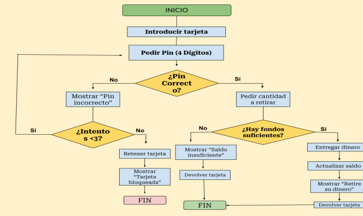

# Nombre del proyecto
## 1. Fundamentos del sistema
El sistema permite retirar dinero mediante una tarjeta bancaria. El usuario introduce la tarjeta, introduce el PIN y solicita una cantidad. El sistema comprueba la validez del PIN y la disponibilidad de fondos antes de entregar el dinero.

## 2. Análisis y especificación de requisitiso
Requisitos funcionales:

Introducir tarjeta.
Validar PIN.
Permitir un máximo de 3 intentos.
Solicitar cantidad a retirar.
Comprobar fondos disponibles.
Entregar dinero.
Actualizar el saldo.
Requisitos no funcionales:

Seguridad en la validación del PIN.
Facilidad de uso para el usuario.

## 3. Diseño
Se ha realizado un diagrama de flujo para representar el funcionamiento del sistema de retirada de efectivo.

## 4. Implementación
- Eliminación de código duplicado.
- Mejora de nombres de variables.
- Reorganización de estructuras condicionales.
- Mejora de la legibilidad del código.
  
## 5. Plan de pruebas del sistema
Introducir un PIN correcto.
Introducir un PIN incorrecto.
Superar los 3 intentos permitidos.
Solicitar una cantidad superior al saldo disponible.
Solicitar una cantidad válida.

### 5.1. Pruebas de aceptación
Nada por aquí 

## 7. Los diccionarios de datos

No hagas nada por aquí
